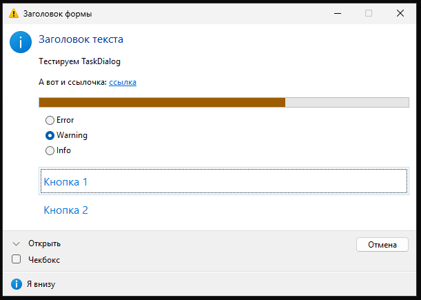
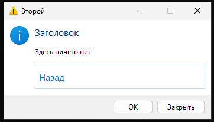

# Документация по фреймворку FASM_OOP
## Содержание  
1. [Введение](#intro)
2. [ООП](#oop)
	1. [ООП: Методы и соглашения о вызовах](#methods)
	2. [ООП: Виртуальные методы и абстрактные интерфейсы](#virtual-methods)
	3. [ООП: Наследование и полиморфизм](#polymorphism)
	4. [Вызов методов и процедур. Типизированные указатели. Макрос $call](#$call)
	5. [Изменения в обработке аргументов $call](#$call-args)
	6. [Обработчики методов](#method-vectors)
		1. [Виртуальные обьекты](#virt-obj)
		2. [Инлайн методы: специальные возможности](#inline)
	7. [Константные поля структур](#const)  
	8. [Выравнивание структур](#align)
3. [Инструменты кросс-архитектурной компиляции](#cross-arch)
	1. [Базовые константы и псевдодирективы](#cross-arch-consts)
	2. [Аргументы процедуры](#cross-arch-proc)
	3. [Возврат и получение значений](#cross-arch-return)
4. [Дополнительные макросы](#additional-macro)
	1. [Include guard(`@module`)](#module)
	2. [Импорт процедур](#importlib)
	3. [Перечисление enum](#enum)
	4. [Конструкция switch-case](#switch)
	5. [Альтернативные анонимные метки](#@block)
	6. [Особые зоны переменных. Пул констант](#variables)
	7. [Работа с TLS(Thread Local Storage)](#tls)
	8. [Инициализация и закрытие модулей. @at_start и @at_end](#at_start-at_end)
	9. [Строковые литералы в стиле Си](#cstr)
	10. [Автоматическое освобождение ресурсов. Макрос `.with`](#with)
	11. [Алиасы типов(`typedef`)](#typedef)
5. [Дополнительные заголовки](#additional-headers)
	1. [Заголовки языка Си](#c-headers)
		1. [assert.inc](#c-assert)
		2. [ctype.inc](#c-ctype)
		3. [errno.inc](#c-errno)
		4. [math.inc](#c-math)
		5. [stddef.inc](#c-stddef)
		6. [stdint.inc](#c-stdint)
		7. [stdio.inc](#c-stdio)
		8. [stdlib.inc](#c-stdlib)
		9. [time.inc](#c-time)
		10. [Заголовки без изменений](#c-others)
6. [Оконные приложения(WinAPI)](#winapi-forms)
	1. [Диалоговые окна задач](#taskdialog)
		1. [Шаблон окна задач](#taskdialog-template)
		2. [Константы шаблона окна задач](#taskdialog-template-consts)
		3. [Макросы шаблона окна задач](#taskdialog-template-macros)
		4. [События](#taskdialog-template-events)
		5. [Активация шаблона](#taskdialog-template-config)
		6. [Создание экземпляра шаблона](#taskdialog-template-create)
		7. [Методы диалогового окна задач](#taskdialog-template-methods)
		8. [Полный пример](#taskdialog-template-example)
<!-- 1. [Обработка исключений](#try-catch) -->
<!-- 2. [Строки](#string) -->
<!-- 3. [Стандартный ввод-вывод Си](#cstdio) -->
<!-- 4. [Заголовок Winuser.inc](#winuser) -->
<!-- 5. [Хуки функций](#hook) -->
<!-- 6. [Работа с Utf8](#utf8) -->
<!-- 7. [Словари](#simple-dict) -->
<!-- 8. [Парсер JSON](#json) -->
<!-- 9. [COM-обьекты](#COM) -->
<!-- 10. [Линковка .obj](#includeobj) -->
<!-- 11. [Оконные приложения](#dialogform) -->

## 1. Введение<a name="intro"/>
Данный проект создавался как расширение стандартных макросов FASM для обеспечения языковой поддержки парадигмы обьектно-ориентированного программирования(на уровне, при котором язык все еще останется низкоуровневым и количество действий под капотом остается минимальным). В процессе развития некоторые стандартные макросы(proc и семейство invoke) были полностью переосмыслены и переработаны, так же были созданы средства, позволяющие обеспечивать кросс-компиляцию приложений под Windows на архитектуры x86-32 и x86-64, выросла стандантрная библиотека и разработан инструментарий для облегченной разработки диалоговых окон на WinAPI.  
_**Важно! Для обьявления и вызова процедур используется пакет https://github.com/ZReticules/FASM-procedures-package-by-Hermes. Формат параметров, передаваемых при вызове процедур и методов, соответствует спецификации, описанной в данном пакете, за исключением строковыx литералы, для них вместо db/du используется [cstr/cwstr](#cstr)**_
## 2. ООП<a name="oop"/>
### 2.1. ООП: Методы и соглашения о вызовах<a name="methods"/>
Базово существует 2 типа методов - `static` и `inline`. Статический метод - функция, имеющая к структуре чисто формальное отношение, привязка статических методов к структуре это не более чем возможность использовать синтаксический сахар при вызове. Инлайн метод, в свою очередь, является макросом, который можно будет вызвать с тем же самым синтаксическим сахаром. Визуально вызов статического и инлайн метода не отличаются, что позволяет при последующих изменениях в коде не менять всю кодовую базу при смене типа метода.  
Так же при обьявлении метода можно указать соглашение о вызовах.  
Ниже можно увидеть пример:  
```asm  
struct Point2
	x dd ?
	y dd ?

	add 	dm Point2.add:static/std ; статический метод add с соглашением о вызвах stdcall, по умолчанию - c
	sub 	dm this ; this - специальное имя, вместо него будет использоваться имя вида StructName.method. 
					; Так же тип метода по умолчанию - статический.
	print 	dm this:inline ; инлайн метод Point2.print
ends
```
Обьявление методов структуры не зависит от обьявления полей.  
В более ранних версиях для обьявления методов использовалось ключевое словво method. Оно так же поддерживается.  
<!-- _**Важно! Если у структуры или ее предка имеется хоть 1 виртуальный метод, то для структуры создается таблица виртуальных методов, а каждый обьект будет так же содаржать в себе указатель на эту таблицу. Для совместимости с предками без виртуальных методов - по отрицательнму смещению.**_   -->
### 2.2. ООП: Виртуальные методы и абстрактные интерфейсы<a name="virtual-methods"/>
Отдельно существует особый тип методов - виртуальные методы. Они реализуются через таблицы виртуальных методов. Виртуальные методы доступны только если в череде предков имеется структура `@interface`:
```asm
struct Point2 @interface
	x dd ?
	y dd ?

	add dm this:virtual ; создание виртуального метода
ends
```
Таким образом структура Point2 и все ее потомки смогут использовать виртуальные методы. Однако у виртуальных методов есть своя цена - будет создана таблица виртуальных методов, а каждый обьект первым полем будет иметь указатель на эту таблицу, что уувеличит размер каждого обьекта на 4-8 байт, а так же потребует дополнительного дереференса при вызове. При этом первый параметр является "теневым", то есть он не будет инициализироваться при указании параметров когда вы создаете эксемпляр структуры. Название поля, содержащего таблицу виртуальных методов обьекта - VTable.  
Абстрактный интерфейс - это структура, которая обьявляет набор стандартных методов, но не реализует их(этим должны заниматься потомки). Для создания такого интерфейса необходимо задать константу `@abstract` на 1(подробнее о константах см. [Константные поля структур](#const)):  
```asm
struct MyInterface @interface
	const @abstract equ 1
	; обьявления полей и методов
ends
```
В таком случае таблица виртуальных методов не будет создана. Переопределив константу @abstract для наследника вы можете создать конкретную реализацию абстрактного интерфейса, где вам нужно будет самостоятельно реализовать все методы.  
### 2.3. ООП: Наследование и полиморфизм<a name="polymorphism"/>
Все методы предка передаются потомку при стандартном наследовании структур в FASM. Потомок может переопределить для себя поведение методов предка - для этого используется макрос override. Синтаксис следующий
```asm
struct Point3 Point2
	z dd ?
	print override Point3.print	; переопределяет унаследованный метод print для структуры Point3. Тип метода остается прежним
	print override this:inline	; перегрузка унаследованного метода print и смена типа метода
ends
```
При перегрузке допустимо менять только типы static и inline. Не допускается смена типа виртуальных методов. Изменить соглашение о вызовах так же возможно.  
### 2.4. Вызов методов и процедур. Типизированные указатели. Макрос $call<a name="$call"/>
Так же в функционал макроса `struct` добавляется создание типа указателя на структуру при обьявлении структуры. Такой типизированный указатель всегда имеет форму P_StructName. То есть для структуры Point2 будет создан так же тип P_Point2. Это позволяет вызывать методы даже для обьектов, находящихся в динамической памяти не тратя регистр для хранения указателя.  
Для вызова как методов структур, так и обычных методов используется макрос `$call`. 
Есть два способа вызова методов: по имени структуры и по имени обьекта. Примеры
```asm
myPoint Point3 1, 2, 3
p_myPoint P_Point3 myPoint

.proc main
	$call myPoint::print()		; вызов метода напрямую через обьект
	$call Point3|print(myPoint)	; вызов метода через имя структуры 
								; виртуальные методы в данном случае вызовутся через таблицу структуры
	$call print<Point3>(myPoint); вызов метода через имя структуры 
								; виртуальные методы в данном случае вызовутся через таблицу обьекта
	$call [p_myPoint]::print()	; вызов метода по указателю на обьект
	ret
.endp
```
  
На архитектуре х86 функции могут использовать различные соглашения о вызовах. Макрос $call на этой архитектуре учитывает эту особенность и позволяет указать соглашение, по которому должен вызываться метод(по умолчанию - cdecl). Пример  
```asm
$call std myPoint::print() ; вызвать метод print для обьекта myPoint по соглашению о вызовах stdcall
```  
По умолчанию доступны соглашения о вызовах stdcall и ccall, однако в дальнейшем могут появиться и другие. Можно создавать и собственные соглашения о вызовах, для этого вы должны создать макрос-обработчик с параметрами аналогично стандартным макросам ccall и stdcall. Именование соответствующее, при вызове макрос $call склеит указанные до вызова самого метода символы с строкой call и попытается передать в макроос с получившимся именем частично отформатированные аргументы.  
Так же макрос $call способен вызывать и обычные процедуры. Примеры: 
```nasm
.proc cdecl add(.arg1, .arg2)
	mov eax, [.arg1]
	add eax, [.arg2]
	ret
.endp

.proc main
	$call add(5, 10)			; вызов статической процедуры. Для ранее обьявленной процедуры соглашение о вызовах 
								; будет выбрано то, с каким она обьявлена. Иначе - stdcall.
	$call [printf]("%d", eax)	; вызов процедуры по адресу из памяти
	ret
.endp
```
### 2.5. Изменения в обработке аргументов $call<a name="$call-args"/>
В FASM_OOP изменена обработка константных литералов. `const` теперь собираются в общий пул констант, которые могу пересекаться друг с другом. Для изменяемых статических обьектов используется ключевое слово static, идентичное использованию const.
### 2.6. Обработчики методов<a name="method-vectors"/>
Как уже было сказано ранее, обработчиком метода может стать любая процедура/макрос в зависимости от типа метода. Однако FASM_OOP предлагает средства, способные облегчить создание методов, такие как виртуальные обьекты и вспомогательные макросы для инлайн-методов.  
#### 2.6.1. Виртуальные обьекты<a name="virt-obj"/>
Для их создания используется макрос virtObj. Виртуальный обьект не инициализирует область памяти, в которой создается и предназначен в первую очередь для удобной работы с передаваемыми в методы адресами обьектов. Пример:              
```nasm
.proc Point2.print(.pthis)
	virtObj .this Point2 at ecx from [.pthis]	; at указывает на адрес, по умолчанию rcx(ecx на x86)
			; from является опциональным, указывает откуда получит значение регистр
			; (если адрес, на который маппится обьект, является одним регистром без смещения).
	$call [printf](<"x: %d, y: %d", 0Ah>, [.this.x], [.this.y])
	ret
.endp
```
Создаваемый таким образом обьект является глобальным, допускается (и рекомендуется) использование локальных меток как в примере.  
#### 2.6.2. Инлайн методы: специальные возможности<a name="inline"/>
В макросы-обработичики инлайн методов параметры передаются так, как если бы они передавались и в статические/виртуальные методы. Однако если в самом методе нам надо выполнить какие-то операции над обьектом, у нас могут возникнуть сложности с тем, чтобы получить значение поля обьекта или переместить параметр в регистр. Для решения этих проблем были созданы макросы fillGPR и inlineObj. Так же для таких методов можно получить количество аргументов в виде переменной этапа компиляции `__argscount__`.  
Пример использования inlineObj:              
```asm
macro Point2.print this{
	local _this					;локальный идентификатор для адреса обьекта
	inlineObj _this, this, rcx	;первый параметр - идентификатор для получившегося адреса, второй - источник значения, третий - регистр
								;в который загрузится значение если параметр окажется памятью(опционально)
	$call [printf](<"x: %d, y: %d", 0Ah>, [_this + Point2.x], [_this + Point2.y])
}
```
Пример использования fillGPR:              
```asm
macro mem_mov dst, src, size{
	fillGPR ecx, size
	fillGPR esi, src
	fillGPR edi, dst
	rep movsb
}
``` 
### 2.7. Константные поля структур<a name="const"/>
Макрос const может создавать константы этапа препроцессинга и константы этапа компиляции для структур. Пример:       
```asm
struct MyStruct
	dd ?
	const a equ 5    ; создаст константное поле этапа препроцессинга
	const b = 6      ; создаст константное поле этапа компиляции
ends
```
К создаваемым таким образом полям можно обращаться только через имя структуры(для вышеприведенного примера - MyStruct.a и MyStruct.b соответственно). Константные поля структур так же наследуются, при этом их можно переопределить.  
### 2.8. Структуры и выравнивание<a name="align"/>
Для удобства работы с структурами из языка Си был расширен стандартный функционал структур путем замены стандартного заголовка struct.inc на модифицированный. Новый заголовок позволяет выбрать режим выравнивания для структур, для совместимости со стандартыми заголовками по умолчанию включен режим default(аналог packed в Си - смещения полей не выравниваются). Переключать режимы выравнивания позволяют следующие макросы:  
```asm
.alignmode_default 		; перевод в стандартный режим
.alignmode_cdecl 		; Си-подобный режим выравнивания
.alignmode_previous 	; возврат к предыдущему режиму выравнивания
.alignmoe_set_pack 		; задает максимальную гранцу выравнивания в режиме cdecl
						; аналог pragma packed
.alignmoe_restore_pack 	; возврат к предыдущей верхней границе выравнивания
```  
Данные макросы управляют глобальным режимом выравнивания. Для точечного выравнивания стоит использовать макрос `alignas`. Его можно использовать при обьявлении новой структуры, [алиаса для типа](#typedef) или для одного из полей структуры:  
```asm
alignas(64) struct Foo 	; если указать число, по нему будет выравниваться размер всей структуры 
	a rb 1
	alignas(dq) b rb 2 	; можно указать для конкретного поля
						; если указать тип(стандартный или структуру), то показатель выравнивания будет 
						; взят от типа
ends 
```  
Для совместимости с C++ при наследовании структур в любом режиме смещение первого поля от начала структуры будет больше или равно размеру родителя. По аналогии с sizeof теперь можно получить выравнивание структуры с помощью `alignof.StructName`.  
## 3. Инструменты кросс-архитектурной компиляции<a name="cross-arch"/>
### 3.1. Базовые константы и псевдодирективы<a name="cross-arch-consts"/>
Для того, чтобы определить, под какой именно архитектурой вы находитесь, вы можете проверить значение `__architecture` следующим образом:  
```asm
match =x86, __architecture{
	; что-то архитектурно-специфическое
}
```
Для x86-32 имеет значение x86, для x86-64 - x64.  
Стандартные 8 регистров общего назначения имеют псевдонимы начинающиеся с p (`pax`, `pbx` и т.д.), все в нижнем регистре, заданные с помощью `fix`.  
Для определения области данных под размер указателя используется псевдодиректива `dptr` или `rptr`. Определены так же константы `pointer` и `POINTER`, которые можно использовать для указания типа аргументов или приведения типа для инструкций. Для тех же целей определена константа `pointer.size`, которая как раз определяет размер указателя на архитектуре(4 на x86-32, 8 на x86-64). Аналогичная константа `pointer.shift` содержит степень 2-ки указателя.  
Константа `PEB` содержит адрес PEB для текущей архитектуры.  
Однострочный макрос `qword_result` содержит формат, в котором традиционно возрващаются значения qword на конкретной архитектуре(rax для x86-64, edx:eax для x86-32).  
Так же определены макросы `PTR_MAX`, `PTR_MIN` и `UPTR_MAX`, которые содержат соответствующие максимальное и минимальное значения для знакового указателя, а так же максимальное значение беззнакового указателя.  
Определены так же псевдонимы под размеры указателя в виде следующих инструкций:  
- movptr(movd/movq)  
- movsptr(movsd/movsq)  
- jpcxz(jecxz/jrcxz)  
### 3.2. Аргументы процедуры<a name="cross-arch-proc"/>
При работе с аргументами обьявленной вами процедуры вы можете использовать псевдонимы для аргументов `@arg{N}` и `@farg{N}`, где N - номер аргумента. Для того, чтобы гарантировать загрузку аргумента в память, под него выделенную, можно использовать `@sarg`. В свою очередь, `@larg` позволяет загрузить значение аргумента в регистр(GPR или SSE). Пример использования:  
```asm
.proc cdecl Point2.add(.pthis, .num)
	virtObj .this Point2 at pcx from @arg1
	@sarg @arg2 		; гарантировать попадание в память
	@larg pdx, @arg2 	; загрузить в регистр(если еще не в нем)
						; всегда стоит использовать универсальные с префиксом p
	add [.this.x], edx
	add [.this.y], edx
	ret
.endp
```
### 3.3. Возврат и получение значений<a name="cross-arch-return"/>
Для возврата значения из `.proc` используется макрос `$return`. `$return` получает один параметр в формате любого аргумента, допустимого для `$call`, и загружает значение в соответствующий стандартный контейнер для результата(eax, edx:eax, st0 для x86-32 и rax, xmm0 для x86-64).  
В свою очередь `$call` умеет получать результат из процедуры следующим образом:  
`$call result = proc(args...)`  
Допустимыми для `result` являются те типы аргументов для `$call`, которые способны хранить значения.  
Это касается в том числе и методов.  
Так же `$return` можно использовать и без аргументов. В таком случае его удобно использовать т.к. он закрывает прологи некоторых расширенных макросов(которые будут рассмотрены позднее).  
## 4. Дополнительные макросы<a name="additional-macro"/>
### 4.1. Include guard(`@module`)<a name="module"/>
Для предотвращения множественных вставок одного и того же загловочного файла в C/C++ используется так называемый include guard. С такой же целью была добавлена следующая конструкция  
```asm
@module Name
; data
@endm
```  
В данном случае происходит увеличение уровня вложенности {}, это означает что становится доступная директива local, что позволит обьявлять локальные идентификаторы, а так же что обьявления макросов или иные директивы, использующие {}, потребуют экранирования с помощью `\`  
```asm
@module Foo
macro bar\{\}
@endm
```  
### 4.2. Импорт процедур<a name="module"/>
Для импорта процедур используется макрос `includelib`. Он позволяет перечислить импортируемые процедуры в любой точке кода, что позволяет делать импорты рядом с функциями, что их используют. По сути это удобная обертка над import и library макросами из стандартного набора. Примеры:
```asm
importlib msvcrt,\ ; по умолчанию трансляция в строку и добавление .dll
	printf,\
	putwc="_putwc" 	; если хотим сделать псевдоним

importlib winuser="user32.dll",\ ; если хотим написать полное
								\; название библиотеки
	MessageBox="MessageBoxA"
```  
Одну и ту же функцию из одной и той же библиотеки можно импортировать несколько раз. При попытке импорта одного и того же символьного имени из разных библиотек будет выведена ошибка.  
### 4.3. Перечисления enum<a name="enum"/>
Для удобного создания перечислений можно использовать макрос enum  
```asm
Foo enum FIRST,\ ; Foo.FIRST = 0 
	SECOND,\ ; Foo.SECOND = 1
	THIRD=14,\ ; Foo.THIRD = 14
	FOURTH 		; Foo.FOURTH = 15
```  
Если не писать имя перечисления перед enum, префикс не будет добавляться.  
### 4.4. Конструкция switch-case<a name="switch"/>
Макрос switch-case позволяет выбирать блок кода на основе соответствия значения переменной/регистра/состояния флагов тому или иному состоянию. Этот макрос не генеирует таблицу прыжков, а использует прямые сравнения с помощью cmp.  
```asm
switch eax
	case 1 ; одно значение
		; code
		jmp end_case ; аналог break
	case 2, 3, 4 ; несколько значений
		; code
		; как в C, можно провалиться из предыдущего блока в
		; следующий
	case [var1] ... +[var2] ; диапазон значений
							; + означает включение границы в диапазон
		; code
		jmp start_case 		; можно так же прыгнуть к началу
							; всех проверок, таким получая что-то похожее на цикл Дейкстры 
	case F nz 				; срабатывает если флаг поднят, сравнения не происходит
		; code
		jmp end_case
	case t 0x100			; вместо cmp используется test
							; прыжок выполняется если после test опущен ZF
		; code
		jmp end_case
	case tn 0x10			; аналогично t, но если ZF поднят
		; code
		jmp end_case
	case_default 			; блок по умолчанию если ни один не сработал
		; code
		; для последнего блока jmp end_case не нужен
end_switch
```  
Если использовать только проверку флагов, switch можно использовать без аргумента.  
### 4.5. Альтернативные анонимные метки<a name="variables"/>
Стандартыне анонимные метки `@@` довольно удобны, однако они ограничены невозможностью многоуровневой вложенности. Для  решения этой проблемы введена конструкция @lock ... @endb
```asm
@block <initcode1>, <initcode2>
; code
jmp @fb ; прыжок к концу блока
jmp @sb ; прыжок к началу блока
@endb <closecode1>, <closecode2>
```  
Конструкция обеспечивает возможность вкладывать анонимные блоки друг в друга. Код инициализации не является частью блока, то есть прыжок к началу не достигнет инициализации. Код завершения является частью блока и прыжок к концу выполнит этот код. Инициализация и завершение являются опциональными.  
### 4.6. Особые зоны переменных. Пул констант<a name="@const"/>
Фреймворк делит статическую память на три условных зоны: неинициализированная зона, статическая зона и пул констант. Статическая зона содержит изменяемые статические переменные, у которых может быть задано начальное значение. Неинициализированная зона отличается отсутствем инициализирующего значения, память под эти переменные не будет занимать места в исполняемом файле, а будет выделена ОС при загрузке в память.  
Для обьявления переменных в этих зонах были так же введены следующие макросы  
```asm
; статический блок
statics
	a db 10  ; метки имеют глобальный характер
	.b dd 10 ; внутри функций лучше начинать имя с точки
ends
; так же доступно однострочное обьявление
static foo:DWORD, bar[10]:BYTE, <jar:db 10, 11>

; блок неинициализированной памяти
bss 
	a db 10 ; инициализирующие значения будут проигнорированы
endb
bss foo:DWORD, bar[10]:BYTE ; аналогично однострочное обьявление

; константный блок - только однострочное обьявление
@const_align equ 16 	; опционально можно задать выравнивание последующих констант в памяти

foo @const db "123", 0  ; Константы могут пересекаться в памяти

restore @const_align 	; восстановить предыдущие настройки выравнивания

bar @const db "23"		; Данное значение уже было сохранено в пуле ранее
						; как часть другой константы, так что bar = foo + 1

```
Константная зона предполагает, что данная переменная НИКОГДА не будет меняться. Полагаясь на это, FASM_OOP использует общий перекрывающийся пул констант. Cоздаваемая в константном пуле метка не содержит информации о типе, при необходимости используйте virtual или virtObj.  
### 4.7. Работа с TLS(Thread Local Stotage)<a name="tls"/>
Для упрощения работы с tls-колбеками используется макрос `TLS_AddCallback`
```asm
.proc TLS_proc(.handle, .reason, .reserved)
	; code
	ret
.endp
TLS_AddCallback TLS_proc
```  
Это позволяет определить функции, которые будут вызываться при создании и завершении потока. Обратите внимание, что и при начале, и при завершении потока вызывается одна и та же функция. Для конкретной причины проверьте значение аргумента `.reason` на соответствие одной из нижеперечисленных констант:  

- TLS_PROCESS_DETACH  
- TLS_PROCESS_ATTACH  
- TLS_THREAD_ATTACH  
- TLS_THREAD_DETACH  
### 4.8. Инициализация и закрытие модулей. `@at_start` и `@at_end`<a name="at_start-at_end"/>
Для предварительной инициализации кода(например, при создании модулей) можно использовать макросы `@at_start` и `@at_end`:
```asm
handle rptr 1 	; так, например, можно один раз получить и постоянно переиспользовать
					; какой-то постоянно нужный дескриптор. Например, дескриптор кучи или модуля
macro module_init{
	$call [handle] = get_handle()
	; code
}
@at_start module_init

; а затем освободить его
macro module_end{
	$call del_handle([handle])
	; code
}
@at_end module_end
```  

_**Важно! Обратите внимание, что составление списка инициализаторов происходит на этапе текстового препроцессинга. Такой код приведет к ошибке:**_  
```asm
if used foo
	bar db "text", 0
	@at_start $call c [puts](bar)
	foo:
		; code
end if
```

_**Чтобы избежать этого, вложите if внутрь:**_  
```asm
if used foo
	bar db "text", 0
	macro foo_init{
		if used foo
			$call c [puts](bar)
		end if
	}
	@at_start foo_init
	foo:
		; code
end if
```
### 4.9. Строковые литералы в стиле Си<a name="cstr"/>
Си дает весьма удобный способ обьявления строковых литералов, который позволяет без прерывания литерала вставлять спецсимволы и байтовые значения посреди литерала, используя экранируемые последовательности `\`. Для использования таких строк в FASM_OOP можно использовать следующие макросы:  
```asm
a cstr "Hello!\n" ; си-строка
b cwstr "Goodbye\10\x19\t" ; широкая си-строка(WCHAR)
```  
Макросы следуют спецификации Си при парсинге литералов. Получающиеся строки всегда нуль-терминированы.
### 4.10. Автоматическое освобождение ресурсов. Макрос `.with`<a name="with"/>  
Для управления временем жизни обьекта можно использовать макрос `.with`. Он позволяет обьявить несколько обьектов, вызвать для них конструкторы(если они имеются для типа) в начале блока и вызвать деструкторы(опять же если имеются) в конце блока или при использовании $return. Пример:  
```asm
struct Foo
	make dm this
	unmake dm this
	p_data rptr 1
ends

.proc cdecl Foo.make(.pthis:P_Foo, .size:DWORD, .val:BYTE) uses pbx
	virtObj .this Foo at pbx from @arg1
	@sarg @arg2, @arg3
	$call [.this.p_data] = [malloc]([.size])
	$call [memset]([.this.p_data], [.val])
	ret
.endp

.proc cdecl Foo.unmake(.pthis) uses pbx
	virtObj .this Foo at pbx from @arg1
	$call [free]([.this.p_data])
	ret
.endp

.proc main
	.with <.a:Foo(10, 'a')>,\ ; чисто конструктор
			<.b:Foo<NULL>(11, 'b')>,\ ; константная инициализация + конструктор
			<.c:Foo<NULL>>,\ ; только константная инициализация
			<.d:Foo> ; без константной инициализации или конструктора
		; code
	.end_with ; вызов деструкторов, закрытие блока
	ret
.endp
```  
Так же есть макросы которые позволяют преждевременно вызвать завершение блока(деструкторы обьектов). Константная инициализация может разрушать значения несохраняемых по abi win32 регистров.  

- `$return` - закрывает все блоки и выходит из функции
- `exit@with` - закрывает все вложенные уровни `.with`
- `break@with` - закрывает один ближайший уровень

_**Категорически не рекомендуется делать прыжок за пределы блока `.with` без вызова оного из этих макросов - это может привести к тому, что деструкторы не будут вызваны!**_  
### 4.11. Алиасы типов(`typedef`)<a name="typedef"/>  
Стандартные структуры FASM довольно удобны, но есть большой минус - даже если мы обьявим структуру вида  
```asm
struct Foo
	rd 1
ends```  
Это все еще не создает возможноть использовать переменные данного типа без спецификации размера, например  
```asm
foo Foo
; code
mov [foo], 1 ; вызовет ошибку, потребует спецификации размера
```  
Это же будет касаться и попытки отправить такой аргумент в функцию без спецификации размера. Для решения этой проблемы был введен макрос typedef:  
```asm
typedef new_type, existed_type
```  
Он по-разному обрабатывает различные виды исходных типов. Если исходный тип - структура, то он выполняет простое наследование. Если исходный тип - встроенный тип или ранее обьявленный алиас для встроенного типа, то будут созданы специальные макросы, позволяющие создавать экземпляры этого типа и приводить адреса к данному типу:  
```asm
typedef int32_t, dword ; создаем алиас
alignas(qword) typedef _int32_t, dword ; алиас с выравниванием, заданным alignas

foo int32_t ; даже для базовых типов инициализатор более не обязателен, по умолчанию ?
bar P_int32_t ; автоматически создается тип указателя
; code
mov [foo], 12 ; считает что dword
mov as_int32_t[eax], 12 ; приведение к типу алиаса 
```  
Для создания алиасов на стандартные типы следует использовать название типа в нижнем регистре. Допустимы следующие названия:  

- `byte`  
- `word`  
- `dword`  
- `pword`  
- `fword`  
- `qword`  
- `tbyte`  
- `tword`  

Кроме того, для корректной передачи параметров в функции, можно обьявить алиасы на следующие типы  

- `real`  
- `float`  
- `double`  

<!-- - `dqword`  
- `xword`  
- `qqword`  
- `yword`  
- `dqqword`  
- `zword` -->
В таком случае as_new_type будет раскрываться в название одного из этих типов и не будет работать для приведения типа адреса в инструкциях. При необходимости можно использовать `virtual` или `virtObj`.
## 5. Заголовки язка Си<a name="c-headers"/>  
В пакет входит набор заголовков стандартной библиотеки Си, использующих `msvcrt.dll`. В связи с особенностями языка ассемблера, его отличающейся макросистемы и особенностей самой `msvcrt.dll` некоторые функции, макросы или глобальне переменные могут отсутствовать или работать не так, как описывает стандарт. В пунктах этой части описаны только отклонения, связанные с особенностями языка/компилятора. За основу брались заголовки отсюда: https://github.com/wine-mirror/wine/tree/master/include/msvcrt.  
Все перечисленные заголовки подключаются как `include "FASM_OOP/c/header`.  
### 5.1. asssert.inc<a name="c-assert"/>
Определяет макросы cassert и cwassert с одним аргументом - логическое выражение, которое способен разобрать макрос `.if` из стандартного пакета fasm. Примеры ипользования:  
```asm
cassert eax > 5 & edx < 10  
cwassert eax > 5 & edx < 10
```  
Псевдоним был введен из-за конфликта имен с директивой `assert`. В остальном функционал идентичен аналогичному макросу в язке Си.  
### 5.2. ctype.inc<a name="c-ctype"/>
Вместо макроса `MB_CUR_MAX` требуется использовать функцию dll `mb_cur_max`, возвращающую значение сишного типа `int`. Взывается как `$call c [mb_cur_max]()`. Так же заголовок импортирует широкие версии функций.  
### 5.3. errno.inc<a name="c-errno"/>
Вместо глобальной переменной errno требуется использовать функцию dll `_errno`, возвращающую значение сишного типа `int*`. Взывается как `$call c [_errno]()`.
### 5.4. math.inc<a name="c-math"/>
Нет автоматического определения размера для числа с плавающей точкой, отдельно функции с суффиксом `-f`:  

| double | float |
| - | - |
| isinf | isinff |
| isnan | isnanf |
| isnormal | isnormalf |
| signbit | signbitf |
| isfinite | isfinitef | 

Нет функций сравнения, нет функций для long double - msvcrt считает их обычными double, а не float80.  
### 5.5. stddef.inc<a name="c-stddef"/>
Нет определения макроса `offsetof`(не требуется).  
Вместо глобальной переменной `_threadid` требуется использовать функцию dll `_threadid`, возвращающую значение сишного типа `unsigned int*`. Взывается как `$call c [_threadid]()`.  
### 5.6. stdint.inc<a name="c-stdint"/>
Нет определения function-like макросов INT*_C/UINT*_C в силу специфики компилятора, который не разделяет типы числовых литералов таким образом.  
### 5.7. stdio.inc<a name="c-stdio"/>
Для обращения к стандартным потокам ввода-вывода требуется дереференс - `mov pax, [stdin]`.  
### 5.8. stdlib.inc<a name="c-stdlib"/>
Вместо макроса `MB_CUR_MAX` требуется использовать функцию dll `mb_cur_max`, возвращающую значение сишного типа `int`. Взывается как `$call c [mb_cur_max]()`.  
Обьявлены глобальне переменные `_(w)argc`(dword), `_(w)argv`(pointer), `_(w)env`(pointer), содержащие значения, передаваемые Си в функцию `main` как аргументы. Без префикса обычные символы, с префиксом широкие.   
### 5.9. time.inc<a name="c-time"/>
Только 64-битный формат времени.  
### 5.10. Заголовки без изменений<a name="c-others"/>
Следующие заголовки портированы без изменений:  

- `fcntl.inc`
- `fenv.inc`
- `float.inc`
- `inttypes.inc`
- `limits.inc`
- `locale.inc`
- `signal.inc`
- `string.inc`
- `wchar.inc`
- `wctype.inc`
- `conio.inc`

## 6. Оконные приложения(WinAPI)<a name="winapi-forms"/>
`FASM_OOP` так же включает в себя инструментарий для разработки оконных приложений под Windows используя WinAPI. На данный момент документированы диалоговые окна задач(TaskDialog), в будущем планируется описание полноценного языка разметки для диалоговых окон.  
### 6.1. Диалоговые окна задач<a name="taskdialog"/>
Диалоговое окно задачи - ограниченно конфигурируемое окно, предназначенное для каких-то задач стандартного ввода пользователем - выбрать один вариант из набора, отобразить справку, подтвердить какое-то действие с различными вариациями исхода и т.д. Для него нельзя полноценно задать разметку, только выбрать отдельный набор компонентов, расположение которых окно определяет уже самостоятельно.  
Официальная документация microsoft находится по [ссылке](https://learn.microsoft.com/ru-ru/windows/win32/controls/task-dialogs).  
#### 6.1.1. Шаблон окна задач<a name="taskdialog-template"/>
Для создания окна задачи необходимо задать шаблон, по которому будут созданы элементы управления и будут обрабатываться события компонента. Пример такого шаблона:  
```asm
struct Task2Template TASKDIALOG_TEMPLATE

	; набор флагов окна - все флаги описаны в документации к АПИ
	const TFLAGS = TDF_CAN_BE_MINIMIZED \
		or TDF_ALLOW_DIALOG_CANCELLATION

	; задаем главную иконку
	const TICON = TDI.INFORMATION

	; выбираем набор стандартных кнопок
	const TCOMMON_BUTTONS = TDCBF_OK_BUTTON or TDCBF_CLOSE_BUTTON
	
	; прочие параметры окна
	@TTitle "Заголовок окна"
	@THeader "Текста"
	@TContent "Содержимое"
	
	; пользовательская кнопка - их может быть сколько угодно
	@TPushButton btn1, "Кнопка"
	
	; задаем колбек для обработки уведомления. Названия уведомления и сообщений принадлежат перечислениям TDN и TDM соответственно
	TDN.BUTTON_CLICKED tevent Task2_pushClicked
ends
``` 

Сама исходная структура TASKDIALOG_TEMPLATE выглядит так:
```asm
struct TASKDIALOG_TEMPLATE
	__sData 	TASK_SERVICEDATA
	p_config 	P_TASKDIALOGCONFIG
ends
```  

Где первое поле является приватным, а второе - указателем на экземпляр структуры конфигурации.  

#### 6.1.2. Константы шаблона задач<a name="taskdialog-template-consts"/>
Стандартные константы  

- Флаги(`const TFLAGS = val`) - идентично оригинальной документации на MSDN для параметра dwFlags структуры [TASKDIALOGCONFIG](https://learn.microsoft.com/ru-ru/windows/win32/api/Commctrl/ns-commctrl-taskdialogconfig)  
- Главная иконка(`const ICON = val`) - одно из значений перечисления TDI для той же структуры(вместо первого \_ будет точка)  
- Иконка примечания снизу(`const TICON_FOOTER = val`) - аналогично предыдущему  
- Кнопка по умолчанию(`const TDEF_PUSH_BUTTON = id`) - id кнопки по умолчанию. Либо id заданной пользователем кнопки, либо одну из стандартных(IDOK, IDCANCEL и т.д.)  
- Радио-кнопка по умолчанию(`const TDEF_RADIO_BUTTON = id`) - id радио-кнопки по умолчанию. Аналогично предыдущему, кроме кнопок по умолчанию - их нет.  
- Ширина окна(`const TWIDTH = val`) - ширина окна. По умолчанию - 0, что устанавливает ширину автоматически.  
- Стандартные кнопки(`const TCOMMON_BUTTONS = val`) - задается сочетанием флагов, определяющих стандартные кнопки, которые используются окном. Значением может быть один или несколько флагов из набора `TDCBF_*`. Полностью описано в документации [TASKDIALOGCONFIG](https://learn.microsoft.com/ru-ru/windows/win32/api/Commctrl/ns-commctrl-taskdialogconfig) параметра dwCommonButtons.  

Служебные константы. Предполагается, что данные константы будут задаваться через специализированные макросы текстовыми значениями. Однако, при желании, их можно задать и напрямую - указателем на нуль-терминированную строку широких символов. Обнулив их вы удаляете соответствующий элемент.  

- Заголовок окна(`const TTITLE_PTR = val`) - задает текст заголовка окна  
- Заголовок текста в окне(`const THEADER_PTR = val`) - задает заголовок для текста в окне  
- Содержимое окна(`const TCONTENT_PTR = val`) - основное содержимое, окновной текст окна  
- Текст для чекбокса(`const TCHECKBOX_PTR = val`) - задает текст для чекбока. Если константа не задана - чекбокс не будет отображаться
- Раскрытый текст(`const TEXPANDED_CONTROL_PTR = val`) - текст для элемента управления, управляющего свернутым текстом, в развернутом состоянии. Если текст для свернутого состояния не задан - используется и для свернутого тоже  
- Скрытый текст(`const TCOLLAPSED_CONTROL_PTR = val`) - текст, отображаемый для элемента управления раскрытием, в свернутом виде  
- Скрываемый текст(`const TEXPANDED_PTR = val`) - текст, видимый пользователю при раскрытии  
- Нижняя заметка(`const TFOOTER_PTR = val`) - текст для заметки снизу(нижний колонтитул/футер)  

#### 6.1.3. Макросы шаблона задач<a name="taskdialog-template-macros"/>
Макросы, определяющие текстовые параметры окна:  

- Заголовок окна: `@TTitle "Text"`  
- Заголовок текста в окне: `@THeader "Text"`   
- Содержимое окна: `@TContent "Text"`   
- Текст для чекбокса: `@TCheckBox "Text"`   
- Раскрытый текст: `@TExpandedControlText "Text"`   
- Скрытый текст: `@TCollapsedControlText "Text"`  
- Скрываемый текст: `@TExpandedText "Text"`  
- Нижняя заметка: `@TFooter "Text"`  

Макросы, задающие набор пользовательских элементов управления окна:  

- Кнопки: `@TPushButton name, "Text"` - кнопка, определяемая пользователем. Получить id можно как `TemplateStruct.name.id`  
- Радиокнопки: `@TRadioButton name, "Text"` - кнопка, определяемая пользователем. Получить id можно как `TemplateStruct.name.id`  

#### 6.1.4. События<a name="taskdialog-template-events"/>
Обработка событий осуществляется через колбеки, определить которые можно через макросы tevent и hook внутри шаблона. При переключении шаблонов меняются не только набор элементов управления, но и обработчики событий. События делятся на две главные категории: стандартные события задач и общие события окон. Обработчик события и того, и другого типа обьявляется почти одинаково:  

- Обработчик события окна задачи: `TDN.EVENT tevent proc_event_handler`  
- Обработчик общего события окна Windows: `WM_EVENT hook proc_event_handler`  

Обработка общего события осуществляется сабклассированием внутри самой обертки.  
Сигнатура обработчика и в первом, и во втором случае одинакова:  
`.proc proc_event_handler(.p_task, .p_params, .p_eventData)`  
Параметры:  

- `.p_task` - указатель на обьект окна  
- `.p_params` - указатель на экземпляр структуры параметров события
```asm
struct Params
	hWnd 	dptr ?
	uMsg 	dptr ?
	wParam 	dptr ?
	lParam 	dptr ?
ends
```
- `.p_eventData` - указатель на данные события - на область памяти сразу после колбека внутри структурыы шаблона. Так можно делать универсальные обработчики, не привязанные к определенному типу шаблона, сохраняя данные между вызовами в специализированной области памяти.  
Интерпретация возвращаемого значения зависит от конкретного вида события.  
Колбек записывается в поле структуры шаблона с именем, идентичным наименованию события. При необходимости его можно подменить в рантайме.  
Полный список событий по [ссылке](https://learn.microsoft.com/ru-ru/windows/win32/controls/bumper-task-dialogs-reference-notifications), в обертке является перечислением, так что необходимо заменять первое \_ на точку.

#### 6.1.5. Активация шаблона<a name="taskdialog-template-config"/>
Для того, чтобы шаблон можно бло использовать, для него после обьявления структуры должен быть создан экземплятор конфигурации. Это делается таким макросом:  
`@MakeTaskConfig Template`  
Конфигурация создается в пуле констант в виде экземпляра структуры TASKDIALOG_CONFIG.  

#### 6.1.6. Создание экземпляра шаблона<a name="taskdialog-template-create"/>
Экзмплеря шаблона рекомендуется создавать так же через дополнительный макрос - `tasktempl`. Он обеспечит правильную инициализацию созданного экземпляра данными, порождаемыми `@MakeTaskConfig`. Если шаблон необходимо оздать в динамической памяти или в локальной переменной, нужно сначала создать шаблон как константу/статический обьект, а затем перенести данные с помощью memset, rep movsb или иным способом, доступным и удобным пользователю. Пример:  
`mytmpl template TemplateStruct`

#### 6.1.7. Методы диалогового окна задач<a name="taskdialog-methods"/>
Управлять состоянием окна задач можно как напрямую через отправку сообщений через SendMessageA, так и методами(инлайн методами по большей части), вызываемыми для экземпляра структуры TASKDIALOG. Список методов с сигнатурами и соответстующих им сообщений:  

| сообщение | метод | 
| - | - |
| - | TASKDIALOG\|run(.pthis, .p_template:P_TASKDIALOG_TEMPLATE, .parent) |
| TDM.NAVIGATE_PAGE | TASKDIALOG\|navigate(.p_task, .p_template:P_TASKDIALOG_TEMPLATE) |
| TDM.CLICK_BUTTON | TASKDIALOG\|clickPushButton(this, btId) |  
| TDM.CLICK_RADIO_BUTTON | TASKDIALOG\|clickRadioButton(this, btId) |  
| TDM.ENABLE_BUTTON | TASKDIALOG\|enablePushButton(this, btId, isEnabled) |  
| TDM.ENABLE_RADIO_BUTTON | TASKDIALOG\|enableRadioButton(this, btId, isEnabled) |  
| TDM.CLICK_VERIFICATION | TASKDIALOG\|setCheckBoxState(this, isChecked, takeFocus) |  
| TDM.SET_BUTTON_ELEVATION_REQUIRED_STATE | TASKDIALOG\|setAdminShieldButton(this, btId, needShield) |  
| TDM.SET_ELEMENT_TEXT | TASKDIALOG\|setContent(this, contentId, p_cwstr) |  
| TDM.UPDATE_ELEMENT_TEXT | TASKDIALOG\|updateContent(this, contentId, p_cwstr) |  
| TDM.SET_MARQUEE_PROGRESS_BAR | TASKDIALOG\|setIsBarMarquee(this, isMarquee) |  
| TDM.SET_PROGRESS_BAR_MARQUEE | TASKDIALOG\|configureMarqueeBar(this, isRunning, uElapse=0) |  
| TDM.SET_PROGRESS_BAR_POS | TASKDIALOG\|setBarPos(this, uPos) |  
| TDM.SET_PROGRESS_BAR_RANGE | TASKDIALOG\|setBarRange(this, uLMinHMax) |  
| TDM.SET_PROGRESS_BAR_STATE | TASKDIALOG\|setBarState(this, state) |  
| TDM.UPDATE_ICON | TASKDIALOG\|updateIcon(this, iIcon, hIcon=NULL) |  
  
Использовать прямую отправку сообщения для навигации крайне нежелательно. Обертка в виде метода использует указаный шаблон, в то время как сообщение потребует от вас вручную заполненного экземпляра структуры конфигурации. Описание сообщений можно посмотреть по [ссылке](https://learn.microsoft.com/ru-ru/windows/win32/controls/bumper-task-dialogs-reference-messages).  

#### 6.1.8. Полный пример<a name="taskdialog-template-example"/>
```asm
define PROGRAM_TYPE GUI 6.0

; заменить при компиляции исходного кода в другой кодировке
include "encoding/utf8.inc"
include "FASM_OOP/x64.inc"
include "FASM_OOP/TASKDIALOG.inc"

entry main

importlib kernel32, \
	ExitProcess

importlib dwmapi,\
	DwmSetWindowAttribute

struct Task1Template TASKDIALOG_TEMPLATE

	; общие флаги
	const TFLAGS = TDF_CAN_BE_MINIMIZED \
		or TDF_ALLOW_DIALOG_CANCELLATION \
		or TDF_ENABLE_HYPERLINKS \
		or TDF_SIZE_TO_CONTENT \
		or TDF_EXPAND_FOOTER_AREA \
		or TDF_NO_DEFAULT_RADIO_BUTTON \ 
		or TDF_SHOW_PROGRESS_BAR \
		or TDF_USE_COMMAND_LINKS_NO_ICON

	; Набор стандартных кнопок
	const TCOMMON_BUTTONS = TDCBF_CANCEL_BUTTON

	; Выбираем иконки
	const TICON 		= TDI.INFORMATION
	const TICON_FOOTER 	= TDI.INFORMATION

	; выбранные контролы по умолчанию
	const TDEF_PUSH_BUTTON 	= Task1Template.btn1.id
	const TDEF_RADIO_BUTTON = Task1Template.radioWarning.id

	; явно указанная ширина
	const TWIDTH = 300

	; текстовые параметры формы
	@TTitle "Заголовок формы"
	@THeader "Заголовок текста"
	@TContent "Тестируем TaskDialog\n\n"#\
							'А вот и ссылочка: <A HREF="https://google.com">ссылка</A>'
	@TCheckBox "Чекбокс"
	@TExpandedControlText "Скрыть"
	@TCollapsedControlText "Открыть"
	@TExpandedText 'Скрытый текст\n\n'#\
		'Здесь сcылочка тоже: <A HREF="https://yandex.ru">ссылка</A>'
	@TFooter "Я внизу"
	
	; Пользовательские кнопки и радиокнопки
	@TPushButton btn1, "Кнопка 1"
	@TPushButton btn2, "Кнопка 2"

	@TRadioButton radioError, "Error"
	@TRadioButton radioWarning, "Warning"
	@TRadioButton radioInfo, "Info"

	; Активация автоматической обработки нажатия ссылок
	@TASKDIALOG.enable_links

	; Колбеки для обработки событий
	TDN.CREATED 				tevent Task1_created
	TDN.BUTTON_CLICKED 			tevent Task1_pushClicked
	TDN.RADIO_BUTTON_CLICKED	tevent Task1_radioClicked
	TDN.NAVIGATED				tevent Task1_navigated
ends

; Активация шаблона
@MakeTaskConfig Task1Template

;Второй шаблон
struct Task2Template TASKDIALOG_TEMPLATE

	const TFLAGS = TDF_CAN_BE_MINIMIZED \
		or TDF_ALLOW_DIALOG_CANCELLATION \
		or TDF_USE_COMMAND_LINKS_NO_ICON

	const TICON = TDI.INFORMATION

	const TCOMMON_BUTTONS = TDCBF_OK_BUTTON or TDCBF_CLOSE_BUTTON
	
	@TTitle "Второй"
	@THeader "Заголовок"
	@TContent "Здесь ничего нет"
	
	@TPushButton btn1, "Назад"

	TDN.BUTTON_CLICKED tevent Task2_pushClicked
ends

@MakeTaskConfig Task2Template

.proc_frame_mode_static

.proc Task1_created(.p_task, .p_params, .p_eventData) uses pbx
	virtObj .task TASKDIALOG at pbx from @arg1
	$call .task::setBarRange(30 shl 16 + 0)
	$call .task::setBarPos(10)
	; Делаем края квадратными
	.local .cornerType:POINTER
	mov [.cornerType], DWMWCP.DONOTROUND
	$call [DwmSetWindowAttribute]([.task.hWnd], DWMWA.WINDOW_CORNER_PREFERENCE, &.cornerType, 4)
	ret
.endp

.proc Task1_navigated(.p_task, .p_params, .p_eventData) uses pbx
	virtObj .task TASKDIALOG at pbx from @arg1
	$call .task::setBarRange(30 shl 16 + 0)
	$call .task::setBarPos(10)
	$return esp
.endp

.proc Task1_pushClicked(.p_task, .p_params, .p_eventData) uses pbx pdi
	virtObj .task TASKDIALOG at pbx from @arg1
	virtObj .params Params at pdi from @arg2

	.local .cornerType:POINTER, .colorref:POINTER
	
	.clickConst @const db "Button clicked, id: "
	.local .finalString[.clickConst.len + 11]:BYTE
	
	$call CNV|fill(&.finalString, &.clickConst, .clickConst.len)

	switch [.params.wParam]
		case IDCANCEL
			$return NULL

		case Task1Template.btn1.id
			; навигация - переключение на другой шаблон
			$call .task::navigate(const tasktempl Task2Template)
			; возврат ненулевого значения предотвращает закрытие окна по нажатию кнопки
			$return esp

		case_default
			$call CNV|intToStr(addr .finalString + .clickConst.len, [.params.wParam], 10)
			$call [MessageBoxA]([.task.hWnd], &.finalString, "", MB_OK)
	end_switch
	$return esp
.endp

.proc Task1_radioClicked(.p_task, .p_params, .p_eventData) uses pbx pdi
	virtObj .task TASKDIALOG at pbx from @arg1
	virtObj .params Params at pdi from @arg2
	switch [.params.wParam]
		case Task1Template.radioInfo.id
			$call .task::updateIcon(TDIE.ICON_MAIN, TDI.INFORMATION)
			$call .task::setBarState(PBST.NORMAL)
			$call .task::setBarPos(10)
			$return esp

		case Task1Template.radioWarning.id
			$call .task::updateIcon(TDIE.ICON_MAIN, TDI.WARNING)
			$call .task::setBarState(PBST.NORMAL)
			$call .task::setBarPos(20)
			$call .task::setBarState(PBST.PAUSED)
			$return esp

		case Task1Template.radioError.id
			$call .task::updateIcon(TDIE.ICON_MAIN, TDI.ERROR)
			$call .task::setBarState(PBST.NORMAL)
			$call .task::setBarPos(30)
			$call .task::setBarState(PBST.ERROR)
	end_switch
	$return esp
.endp

.proc Task2_pushClicked(.p_task, .p_params, .p_eventData)
	virtObj .task TASKDIALOG at pcx from @arg1
	; навигация - переключение на исходный шаблон
	$call .task::navigate(const tasktempl Task1Template)
	$return esp
.endp

.proc main
	.local .myTask:TASKDIALOG
	; запуск с указанием начального шаблона
	$call .myTask::run(const tasktempl Task1Template, NULL)
	$call [ExitProcess](0)
.endp

; указываем манифест - иначе апи будут недоступны.
data resource

directory RT_MANIFEST, manifests

resource manifests,\ 
	1, LANG_ENGLISH or SUBLANG_DEFAULT, manifest

resdata manifest
	file "FASM_OOP\manifest.xml"
endres

end data
```  

<figure>
<figcaption>Первая страница</figcaption>  
	
</figure> 

<figure>
<figcaption>Вторая страница</figcaption>  
	
</figure>  